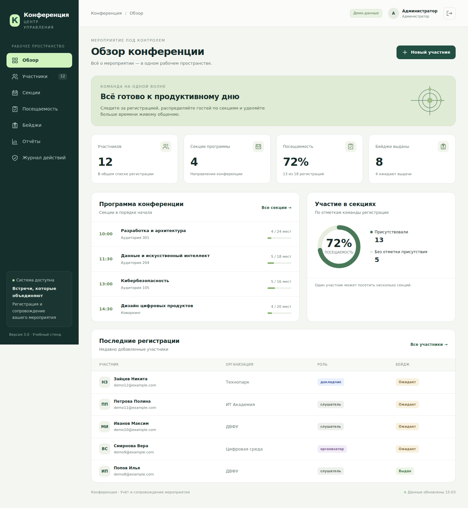

# Конференция

Система регистрации участников, распределения по секциям, учёта посещений и выдачи бейджей. Продолжение проекта УП.02, переработанное для УП.03 «Сопровождение и обслуживание программного обеспечения компьютерных систем».



## Быстрый запуск на Windows

Нужен **Python 3.12**. Установите его с [python.org](https://www.python.org/downloads/) и добавьте в PATH. Распакуйте проект, откройте терминал в его папке:

```bat
scripts\setup.bat
scripts\run.bat
```

Откройте **http://127.0.0.1:8000**. База и вымышленные демо-данные создаются автоматически. Остановка — Ctrl+C. Повторный запуск сохраняет изменения. IDE, Node.js и отдельный сервер БД не нужны.

| Логин | Пароль только для демо | Права |
|---|---|---|
| admin | DemoAdmin!2026 | Все операции, экспорт, восстановление, аудит |
| operator | DemoOperator!2026 | Участники, регистрация, посещения, бейджи |
| viewer | DemoViewer!2026 | Сводки и программа без персональных записей |

## Linux и macOS

```sh
make setup
make run
```

Без Make: `python3 -m venv .venv`, `.venv/bin/python -m pip install -r requirements-dev.txt`, `.venv/bin/python main.py`.

## Проверки

```bat
scripts\check.bat
scripts\build.bat
```

Эквиваленты — `make check`, `make build`. Проверка останавливается на ошибке линтера, форматирования или тестов; порог покрытия 80%. Релиз создаётся в `release/conference-v3.0.0.zip`, контрольная сумма — `release/SHA256SUMS.txt`.

Проверка UI: `.venv\Scripts\python.exe -m playwright install chromium`, затем `.venv\Scripts\python.exe scripts\ui_smoke.py`. Скрипт сам поднимает временный сервер и отдельную демо-базу. В Linux замените интерпретатор на `.venv/bin/python`.

## Возможности

- Единый адаптивный интерфейс на русском, поиск и фильтры.
- Создание и редактирование участников, уникальность email, роли участников.
- Секции с расписанием и вместимостью, защита от одновременного переполнения.
- Регистрация на секции, отметки посещения и отмена записи.
- Печатные бейджи; выдача отмечается отдельно от открытия окна печати.
- Сводки, JSON и CSV, проверяемое восстановление данных.
- Серверные сессии, CSRF, роли сотрудников, аудит и healthcheck.
- Резервные копии SQLite, Makefile/BAT, Docker и CI.

## Стек и файлы

Python 3.12 · FastAPI · Pydantic · SQLite · Uvicorn · HTML/CSS/JavaScript. Ресурсы интерфейса локальные. Точные версии 17 библиотек приложения — в requirements.txt.

| Путь | Назначение |
|---|---|
| main.py, config.py | Приложение, запуск и настройки |
| database.py, models.py, security.py | Хранилище, валидация, права |
| routers/ | API предметных модулей |
| frontend/ | Интерфейс и стили печати |
| scripts/, tests/ | Обслуживание и проверки |
| docs/ | Инструкции, риски, тест-план, инцидент |
| submission/ | Отчёты Word по шести этапам |
| evidence/ | Реальные результаты и снимки приложения |
| .github/ | CI и шаблоны Issue/PR |

## Инструкции

[Установка](INSTALL.md) · [Развёртывание](DEPLOYMENT.md) · [Демонстрация](DEMO_GUIDE.md) · [Сдача и GitHub](docs/SUBMISSION_GUIDE.md) · [Безопасность](SECURITY.md) · [Релиз](RELEASE_NOTES.md).

Результаты локальных проверок находятся в evidence/logs. Docker, BAT на Windows и GitHub Actions требуют выполнения в соответствующей среде: файлы подготовлены, внешние успешные запуски заранее не заявляются. Ссылка на будущий репозиторий и ФИО/группа не предоставлены; заполните repo_link.txt и персональные поля отчётов перед сдачей. История работы приложена как Git bundle.
